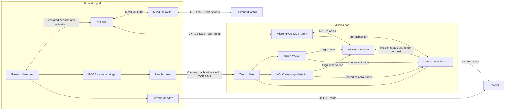
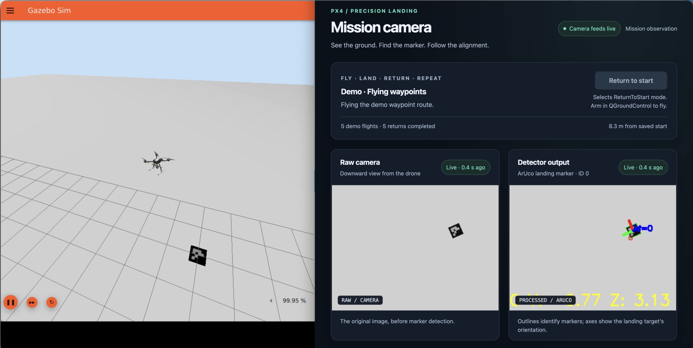
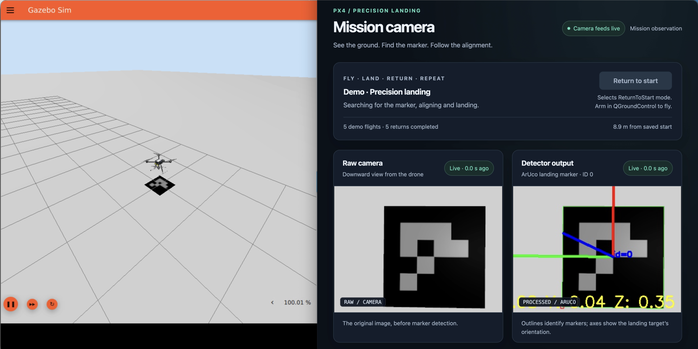
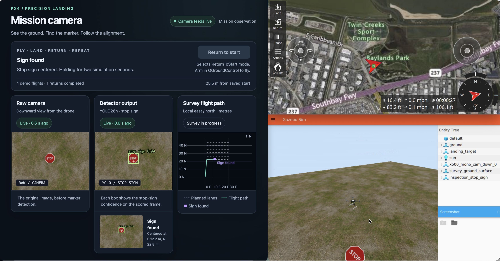

# PX4 Mission on OpenShift

A software-in-the-loop (SITL) project for developing and testing ROS 2 flight modes against PX4 and Gazebo Harmonic on OpenShift. Choose between two missions in QGroundControl. **DemoWaypoints** flies four waypoints. **SignSurvey** searches at 5 m using the drone’s downward camera and YOLO. Both missions land on an ArUco marker and can return to the saved takeoff position. [Stop-sign survey setup](docs/stop-sign-survey.md#install)

## Architecture

For a walkthrough of the runtime connections, mission lifecycle, and repository layout, see the [architecture guide](docs/architecture.md).

The [Helm chart](deploy/chart) deploys two pods. The simulator pod runs PX4 SITL with the [Gazebo world and camera configuration](deploy/chart/files/simulation) mounted from a ConfigMap. It also runs the Gazebo-to-ROS bridge, a MAVLink router for QGroundControl, and a Gazebo desktop served through noVNC. The mission pod runs the ROS 2 mission executor, YOLO stop-sign detector, and ArUco tracker alongside the Micro XRCE-DDS Agent and camera dashboard.



- **Flight control.** The [mission executor](applications/mission_demo/) registers `DemoWaypoints`, `SignSurvey`, and `ReturnToStart` with PX4 through the PX4 ROS 2 Interface Library. Telemetry and flight commands travel through the uXRCE-DDS Agent Service. QGroundControl uses a separate MAVLink link for mode selection, arming, and manual control.
- **Perception.** The Gazebo bridge publishes `/camera`, `/camera_info`, and `/clock` in the simulator DDS domain (61 by default). Zenoh forwards those three topics through an internal Service to the mission domain (62 by default). The [ArUco tracker](applications/aruco_tracker/) publishes the target pose for precision landing and the annotated image for the dashboard.
- **Session state.** The [dashboard](applications/dashboard/) displays camera feeds and mission status. Its return action requests the `ReturnToStart` mode, which requires a separate arm in QGroundControl. Replacing the mission process clears the saved start and counters. Replacing the simulator pod resets the simulated world.

## Prerequisites

- An existing OpenShift project on a cluster with AMD64 workers and an OpenShift router. The simulator pod requests 1.1 CPU and 5568 MiB of memory. The mission pod requests 0.7 CPU and 768 MiB.
- Python 3.9+, Git, Helm, and an authenticated `oc` client with permission to manage workloads, Routes, and Helm release Secrets in the project.
- A browser for the dashboard and Gazebo desktop, and QGroundControl on the machine running the port forward.
- For cluster builds, an integrated image registry and permission to create builds and ImageStreams in the project. For builds elsewhere, a Docker builder and a registry where you can push images that the cluster can pull.

Run the commands from the repository root and replace `my-mission` with your OpenShift namespace.

## Build the images

Build the mission, Gazebo desktop, and MAVLink router images. Both build paths use the same Dockerfiles and [pinned inputs](dependencies.lock.json). The cluster pulls the published PX4/Gazebo and Zenoh images by digest.

The builder needs access to GitHub, Docker Hub, and the package repositories configured in the base images.

### Build on OpenShift

```sh
./demo build --namespace my-mission
```

The launcher builds the three images in your project, pushes them to the integrated registry, and writes `images.lock.json` with the resulting digests. The mission image includes both flight modes and the YOLO stop-sign detector.

### Build with Docker elsewhere

Build the three project images for `linux/amd64` using the [Dockerfiles](containers). Use the [build context staging helper](build/build.py) to include the PX4 messages that match the simulator. Push the images to a registry OpenShift can pull from, then record their digests in `images.lock.json` alongside the pinned PX4/Gazebo and Zenoh references.

## Deploy on OpenShift

Pass the image lock from either build path to the launcher.

```sh
./demo deploy --namespace my-mission --images images.lock.json
```

The launcher installs the Helm chart and waits for live camera data, vehicle telemetry, and registration of the available operator flight modes. It then prints the camera dashboard and Gazebo desktop HTTPS URLs. Anyone who can reach either Route can access its interface.

In a separate terminal, forward the MAVLink TCP port and leave the command running while QGroundControl is connected.

```sh
oc -n my-mission port-forward deploy/px4-mission-simulator 5760:5760
```

For concurrent releases on a shared network, assign each release its own [DDS domain pair](docs/build.md#dds-domain-configuration).

## Demo walkthrough

### Connect to the simulator

Open both HTTPS URLs from the deploy output. The Gazebo desktop shows the vehicle and landing marker in the world. The camera dashboard shows the downward-facing feed and the detector's annotated output.

In QGroundControl, open **Application Settings → Comm Links**, add a **TCP** link to host `127.0.0.1` on port `5760`, and connect. Wait for the vehicle to appear in Fly View and for the dashboard to show **Ready for the next run**. [QGroundControl communication links](https://docs.qgroundcontrol.com/master/en/qgc-user-guide/settings_view/comm_links.html)

### Fly the waypoint route

In QGroundControl's Fly View, select **DemoWaypoints** from the flight mode menu, then arm using the flight status menu. The mission saves the starting position on the first run. The vehicle takes off and flies four waypoints. Watch for **Demo · Flying waypoints** on the dashboard. The downward-facing feed can show only the ground until the marker comes into view.



### Watch the precision landing

After the final waypoint, the dashboard shows **Demo · Precision landing**. The detector outlines marker ID 0 and draws its orientation axes. As the vehicle aligns, the reported X and Y offsets approach zero. Z decreases during the descent. Wait for **Demo complete** and confirm the vehicle has disarmed.



### Fly the stop-sign survey

The Gazebo world starts with a face-up stop sign on the first survey lane. You can fly the scene shown below immediately after connecting.

For a manual flight, select **SignSurvey** in QGroundControl and arm. The downward camera shows live YOLO detections as the drone surveys six lanes. On seeing the face-up inspection sign, the drone aligns over it at 5 m and holds for two continuous simulation seconds. The map shows planned lanes, the flown path and a single **Sign found** marker at the hold position. An empty survey completes all six lanes. Both outcomes return to the ArUco pad for landing. [Setup, fixture placement and replay](docs/stop-sign-survey.md)



### Return to the saved start

Click **Return to start** on the dashboard after the vehicle has landed and disarmed. Once the dashboard shows **Return selected · Arm in QGroundControl**, confirm **ReturnToStart** is active in QGroundControl and arm there. The vehicle takes off again, flies back to the saved start, lands, and disarms. When the dashboard shows **Ready for the next run**, select **DemoWaypoints** or **SignSurvey** in QGroundControl for the next flight.

## Uninstall

```sh
./demo remove --namespace my-mission
```

The command uninstalls the Helm release and retains the OpenShift project and build artifacts.

## Development

Edit the ROS packages under [applications](applications) or the deployment and scenario under [deploy/chart](deploy/chart). Rebuild after changing application code or container recipes. Deploy chart and scenario changes using the existing image lock. The [build guide](docs/build.md) describes the image inputs and validation commands.

Local research, model-training runs, and recorded flights can be kept in the Git-ignored `experiments/` directory. The build packages the detector from `models/`. The replay uses the same world, meshes, and textures that Helm deploys from `deploy/chart/files/`.

## References

- The waypoint and precision-landing examples draw on the *Hands-On Aerial Robotics Using PX4 and ROS 2* workshop from ROSCon 2025. [Workshop materials](https://github.com/Dronecode/roscon-25-workshop)
- [Source attribution and third-party notices](docs/THIRD_PARTY_NOTICES.md)
