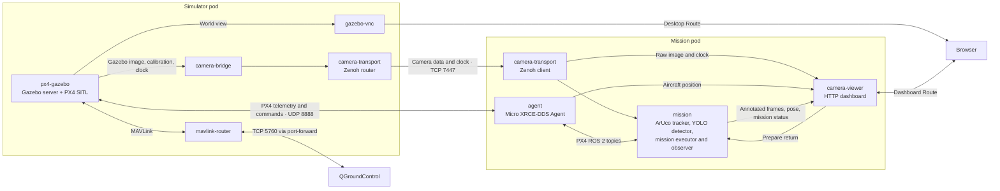

# How the PX4 mission demo works

This project runs a simulated quadcopter on OpenShift. Gazebo provides the world, physics, and camera. PX4 runs the autopilot in software-in-the-loop (SITL), exchanging simulated sensor readings and actuator outputs with Gazebo. The ROS 2 mission application registers the waypoint and stop-sign survey modes with PX4. Both use the downward camera for precision landing on the ArUco pad. [Demo walkthrough](../README.md#demo-walkthrough)

## What runs where

The Helm chart creates two single-replica Deployments. The **simulator pod** owns the simulated vehicle and world. The **mission pod** runs both detectors, sequences the selected flight, and serves the dashboard. Container names in the diagram match the [simulator](../deploy/chart/templates/simulator.yaml) and [mission](../deploy/chart/templates/mission.yaml) manifests.



**World and replay scenes.** Helm mounts the world, meshes, and textures at `/etc/mission-sim` in both `px4-gazebo` and `gazebo-vnc`. Gazebo loads the sign on the first survey lane at startup. The replay fixture reads that same world definition to restore the early scene, move the sign for a late sighting, or remove it for an empty survey. [World definition](../deploy/chart/files/simulation/mission_landing.sdf) · [Replay fixture](../tests/survey_sitl/fixture.py)

**Camera and simulation time.** The simulator runs headless. Its camera bridge converts Gazebo messages into three ROS 2 topics in the simulator DDS domain (default 61). DDS domains group ROS 2 participants for discovery and communication. The mission-side Zenoh client connects to the simulator-side router through the camera Service. The pair forwards only `/camera`, `/camera_info`, and `/clock` into the mission domain (default 62). The mission and dashboard use multicast for DDS discovery and unicast for camera samples within the mission pod. The tracker and executor use the simulation clock. The bridge’s topic mappings and the two transport configurations define this path. [Camera bridge launch](../applications/runtime/bridge.launch.py) · [Simulator router](../deploy/chart/files/zenoh-simulator.json5) · [Mission client](../deploy/chart/files/zenoh-mission.json5)

**Stop-sign perception.** OpenCV resizes the camera frame and prepares the input tensor. ONNX Runtime runs YOLO26n on the CPU to produce the stop-sign bounding box. The detector uses OpenCV and the camera calibration to locate the box midpoint on the known sign face and draw the dashboard overlay. The detector publishes a timestamped observation on `/mission/survey_observation` for the flight mode and an annotated frame on `/mission/survey_preview` for the dashboard. The dashboard draws planned lanes from mission status and the flown path from PX4 local-position telemetry. The ROS launch file restarts the detector independently if it exits unexpectedly. [Survey detector](../applications/runtime/survey_detector.py) · [Survey guide](stop-sign-survey.md)

**PX4 telemetry and commands.** Although PX4 runs in the simulator pod, its XRCE-DDS client uses the **mission** domain. At startup the simulator resolves the Agent Service address. The Agent exposes PX4 telemetry to ROS 2 and carries commands and mode-registration traffic back to PX4. Both the Agent and camera Services publish their endpoints before the pods are ready, so these connections can supply the data that readiness depends on. [Simulator startup](../deploy/chart/files/simulation/start-simulator.sh) · [Services and Routes](../deploy/chart/templates/services.yaml)

**Operator interfaces.** QGroundControl connects to the simulator pod’s MAVLink router through a TCP port-forward for mode selection and arming. The browser has two HTTPS Routes. The desktop Route serves a Gazebo GUI attached to the running world through noVNC. The dashboard Route serves the camera images and mission status and accepts a request to select the return mode. [Desktop startup](../containers/desktop/start-vnc.sh) · [Dashboard server](../applications/dashboard/camera_view.py)

## One demo and return cycle

1. **Wait for PX4 and register the modes.** The mission container waits for a PX4 vehicle-status message before launching the tracker, YOLO detector, executor, and observer. PX4 registers `DemoWaypoints`, `SignSurvey`, `ReturnToStart`, and the internal `DemoPrecisionLand` mode. Each selectable mission has its own executor. Both demos share the precision-landing mode, saved start, and return sequence. [Mission launch](../applications/runtime/mission.launch.py) · [Mode registration](../applications/mission_demo/main.cpp)
2. **Fly the selected mission.** The operator selects the demo mode and arms in QGroundControl. The first valid activation saves the local north-east-down position and heading. After takeoff, `DemoWaypoints` flies four waypoints. `SignSurvey` searches up to six lanes at 5 m. When the drone holds over the centered sign, the dashboard pins the annotated hold frame and marks the aircraft’s location as **Sign found**. Both modes continue to precision landing. [Flight sequence](../applications/mission_demo/MissionExecutor.cpp) · [Survey operation](stop-sign-survey.md)
3. **Land on the marker.** The tracker uses OpenCV’s ArUco module to detect the landing marker and draw its outline. It publishes the camera view on `/image_proc` even when the marker is out of view. When it detects the configured marker and has camera calibration, it publishes the marker’s pose relative to the camera on `/target_pose`. The landing mode consumes that pose. The dashboard displays the raw and processed frames alongside session progress from `/mission/demo_status`. The executor counts the run after disarm. [Tracker](../applications/aruco_tracker/ArucoTracker.cpp) · [Session state](../applications/mission_demo/DemoSession.cpp)
4. **Return to the original start.** The dashboard’s **Return to start** button calls the ROS 2 service `/mission/prepare_return`. The executor checks the saved start, telemetry, and landed/disarmed state before selecting `ReturnToStart`. The operator arms separately in QGroundControl. The return sequence takes off, flies above the saved start, and uses PX4’s land operation. After disarm, the session checks the final position before marking itself ready for another run. [Return mode](../applications/mission_demo/ReturnToStart.cpp) · [Mission package guide](../applications/mission_demo/README.md)

The saved start and run counters live in the mission process. They survive a demo/return cycle and clear when that process restarts. The simulated world lives with the simulator pod and resets when that pod is replaced.

## From source to a ready release

| Stage | What happens |
| --- | --- |
| Build inputs | The checked-in `dependencies.lock.json` pins upstream source revisions and images. The builder stages PX4 message and service definitions from the revision paired with the simulator image so the ROS 2 message types match the running autopilot. [Dependency lock](../dependencies.lock.json) · [Build staging](../build/build.py) |
| Image assembly | `./demo build` runs three OpenShift builds for the mission, desktop, and MAVLink router images. The mission image includes both flight modes, the YOLO26n ONNX model, and ONNX Runtime. Its build compiles the ROS packages and runs the executor regression test. After all builds succeed, the builder writes `images.lock.json` with the three output digests and the prebuilt simulator and Zenoh references. [Mission Dockerfile](../containers/mission/Dockerfile) · [Build guide](build.md) |
| Deployment | `./demo deploy` passes the five runtime image references to Helm. The chart mounts the world, simulator startup script, and Zenoh settings from ConfigMaps. The mission image serves four container roles across the pods. Its entrypoint dispatches the mission launch, camera bridge, XRCE-DDS Agent, or dashboard command supplied by the chart. [Launcher](../demo) · [ConfigMaps](../deploy/chart/templates/config.yaml) · [Image entrypoint](../applications/runtime/entrypoint.sh) |
| Readiness | The observer records an advancing clock, fresh camera frames and calibration, and PX4 status and position in `/tmp/mission-status.json`. The mission probe checks that report. After both rollouts, the launcher checks the dashboard for fresh raw, ArUco, and YOLO frames, fresh mission status, valid telemetry, and distinct IDs for the registered operator modes before printing the Routes. Marker detection becomes relevant later, during landing. [Observer](../applications/runtime/observe.py) · [Probe](../applications/runtime/ready.py) · [Launcher](../demo) |

## Repository map

```text
px4-mission-openshift-demo/
├── README.md                                # Setup and demo walkthrough
├── demo                                     # CLI for building, deploying, and removing the demo
├── dependencies.lock.json                   # Pinned upstream images and source revisions
├── applications/
│   ├── runtime/                             # Process startup and readiness
│   │   ├── entrypoint.sh                    # Dispatches the role selected by the chart
│   │   ├── bridge.launch.py                 # Starts the simulator-side camera and clock bridges
│   │   ├── mission.launch.py                # Starts both detectors, the executor, and the observer
│   │   ├── survey_detector.py               # Publishes sign observations and annotated frames
│   │   ├── observe.py                       # Writes the latest data freshness report
│   │   ├── ready.py                         # Reads that report for the readiness probe
│   │   └── test_observe.py                  # Checks observer behavior
│   ├── mission_demo/                        # C++ flight modes, sequencing, and session state
│   │   ├── main.cpp                         # Registers the modes and executors with PX4
│   │   └── test/executor_regression.cpp     # Exercises the executor against simulated PX4 messages
│   ├── aruco_tracker/                       # Detects the landing marker and publishes its pose
│   └── dashboard/                           # Python HTTP server and HTML camera view
├── models/                                  # ONNX model packaged in the mission image
├── build/
│   ├── build.py                             # Stages sources and submits the image builds
│   └── openshift/buildconfig.json           # Template for OpenShift binary builds
├── containers/
│   ├── mission/                             # Shared image for ROS nodes, Agent, bridge, and dashboard
│   ├── desktop/                             # Gazebo GUI image, VNC startup, and noVNC server
│   └── mavlink-router/                      # Image for the QGroundControl connection
├── deploy/chart/
│   ├── values.yaml                          # Default DDS domains and container resources
│   ├── templates/                           # Deployments, Services, Routes, and ConfigMaps
│   └── files/
│       ├── simulation/                      # Gazebo world and simulator startup script
│       ├── textures/                        # Ground and stop-sign textures
│       ├── zenoh-simulator.json5            # Simulator-side camera transport router
│       └── zenoh-mission.json5              # Mission-side camera transport client
├── tests/
│   ├── survey_sitl/                         # Survey fixtures, recorder and replay evaluator
│   ├── dashboard_http.py                    # Dashboard HTTP checks
│   └── replay_sitl.py                       # Opt-in end-to-end mission replay
├── docs/                                    # Architecture, build guide, notices, and screenshots
└── licenses/                                # Third-party license texts
```

Changes under `applications/` or to a container recipe take effect through a rebuilt image and an updated runtime image lock. Changes to the chart’s world, meshes, textures, startup script, or transport settings take effect by redeploying the chart with the existing image lock. The launcher checks for a landed, disarmed simulation before applying a changed manifest to an existing release. [Build and operations](build.md)
